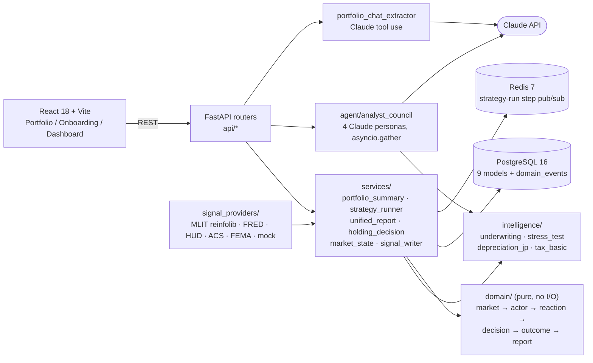

# Tokyo Workforce-Housing Investor Analytics

[](https://github.com/yuto-49/real-estate-agent/actions/workflows/ci.yml)

Underwrite a rental portfolio, pull in market signals, and test whether an investment
strategy holds up over a multi-year forward projection. Built with FastAPI, React and the Claude API.

## Problem / who it's for

Small and mid-size investors in Tokyo workforce housing (one-room mansions, small wood/steel
アパート, family units) usually make buy/hold decisions in spreadsheets. They mix yield math,
Japanese depreciation rules (法定耐用年数) and scattered public data (MLIT transaction prices,
land prices, hazard maps). This platform puts those in one place. The numbers come from
deterministic code. Claude is used only where language helps: reviewing a listing and turning
free text into structured data.

## What I built

- **Portfolio analysis.** Per-holding cap rate, cash-on-cash, DSCR, IRR and a
  hold/sell/refi recommendation, plus an attention list (`GET /api/portfolio/{id}/summary`).
- **Underwriting and stress testing.** Deal underwriting and a seeded Monte Carlo stress test
  over five sliders (vacancy, rent growth, expense growth, loan rate, exit cap). The output
  includes a tornado breakdown.
- **Japanese depreciation engine.** 法定耐用年数 by construction type, 簡便法 residual life for
  used buildings, and the tax shield and the year it runs out (`intelligence/depreciation_jp.py`).
- **Strategy simulation.** The investor describes a strategy in free text. It is extracted into a
  `StrategyProfile` they can review, then projected over the hold period for each holding. A
  final report checks whether today's recommendations still hold at the end of the projection.
- **Claude analyst council.** Four Haiku personas (risk, location, depreciation, vacancy/demand)
  review a listing in parallel and their scores are combined with fixed weights
  (`POST /api/listings/{id}/analyze`).
- **Chat portfolio import.** Claude reads a free-text description of an investor's holdings and
  returns them as rows through a structured tool call. The user confirms the rows before
  anything is saved. CSV import uses the same insert path.
- **Market-signal pipeline.** Pluggable providers for MLIT 不動産情報ライブラリ (transactions, land
  price, appraisal, hazard tiles), plus US sources (FRED, HUD FMR, Census ACS, FEMA NFHL, Chicago
  crime) and a deterministic mock. All of them write through one idempotent upsert.
- **Frontend.** React 18 + TypeScript: onboarding wizard, map dashboard (MapLibre), and a
  six-tab portfolio page (Analysis, Holdings, Underwrite, Stress Test, Decisions, Simulation).



## Key engineering decisions

- **The math is deterministic; the LLM interprets it.** Underwriting, stress tests, depreciation,
  strategy projection and the final report are plain Python with no LLM calls. The
  depreciation persona is given a schedule computed in `depreciation_jp.py` and does not do the
  arithmetic itself. This keeps the numbers reproducible and testable.
- **The agent design is a council, not one agent with many jobs.** Each persona has a narrow
  prompt, makes one Haiku call and returns structured JSON. The four calls run with
  `asyncio.gather`. If a persona hits an API error or returns bad JSON, its result is recorded
  as an error and left out of the score; the rest of the council still returns. Each listing
  review costs at most 4 Claude calls.
- **Tool use for extraction, with a person in the loop.** Chat import makes Claude return holdings
  through a `record_portfolio_holdings` tool whose schema matches the Pydantic create model.
  The results are only suggestions; nothing is saved until the user confirms.
- **The Anthropic client is injected.** It is passed in as a FastAPI dependency (chat import)
  or as an argument (council), so tests use fakes and no API key is needed to run the suite.
  Strategy-profile extraction is a heuristic parser behind a protocol, so the strategy pipeline
  runs without Claude.
- **Mock-first providers.** Market data defaults to `mock`, and every signal provider follows a
  `Protocol`. Real providers retry with `tenacity` and take an injected `httpx.AsyncClient`;
  tests swap in `httpx.MockTransport`. Adding a provider means writing one class and adding
  one entry to the registry.
- **Idempotent signal writes.** Every market signal goes through `signal_writer.upsert_signal`.
  A second write on the same calendar day updates the existing row and a write on a new day
  inserts one, so backfills and cron fetches can run again safely.
- **A pure domain layer.** `domain/` returns frozen dataclasses and never touches the DB, Redis
  or Claude. When data is missing it logs a warning and returns a default instead of raising.
  All I/O lives in `services/` and `api/`.
- **Audit trail and tracing.** Strategy runs append `started`/`completed`/`failed` events to an
  append-only `domain_events` table through a single writer (`EventStore`). A middleware tags
  each request with a correlation ID. Runs execute as FastAPI background tasks, and the
  correlation ID is captured before the task starts because the contextvar does not carry
  over into it. Step progress is published to Redis pub/sub on a best-effort basis.
- **Alembic owns the schema.** The app never calls `create_all`. Alembic runs against the async
  engine, and its history records the scope change: migration `f9a1b2c3d4e5` drops the 15
  tables of an earlier negotiation/simulation design.
- **Deployment.** There is a `python:3.11-slim` Dockerfile and a production compose file
  (Postgres 16 + Redis 7 with healthchecks, 2 app replicas, resource limits). `app.yaml` is a
  DigitalOcean App Platform template. The frontend loads browser-safe settings at runtime from
  `/api/config/public`, so they are not baked in at build time.

## Tech stack

**Backend:** Python 3.11, FastAPI, Pydantic v2, SQLAlchemy 2.0 (async) + asyncpg, Alembic,
Redis, structlog, tenacity, httpx, PyJWT, Anthropic SDK<br/>
**Frontend:** React 18, TypeScript, Vite, React Router, MapLibre GL, Supabase JS<br/>
**Data:** PostgreSQL 16, Redis 7<br/>
**Testing:** pytest + pytest-asyncio (in-memory SQLite, fakeredis), Vitest + Testing Library, Playwright

## Run it locally

Prerequisites: Python 3.11+, Node 18+, Docker.

```bash
# 1. Postgres + Redis
docker run -d --name dev-postgres -e POSTGRES_USER=dev -e POSTGRES_PASSWORD=dev \
  -e POSTGRES_DB=realestate -p 5432:5432 postgres:16-alpine
docker run -d --name dev-redis -p 6379:6379 redis:7-alpine

# 2. Backend (http://localhost:8000, docs at /docs)
cp .env.example .env            # ANTHROPIC_API_KEY is only needed for the council and chat import
python -m venv .venv && source .venv/bin/activate
pip install -e ".[dev]"
alembic upgrade head
python scripts/seed_properties.py && python scripts/seed_dev_portfolio.py
uvicorn main:app --reload

# 3. Frontend (http://localhost:5173, proxies /api to :8000)
cd frontend && npm install && npm run dev
```

<details>
<summary>Windows (PowerShell)</summary>

Use the same `docker run` commands (replace `\` line breaks with a backtick), then:

```powershell
copy .env.example .env
python -m venv .venv; .venv\Scripts\Activate.ps1
pip install -e ".[dev]"
alembic upgrade head
python scripts\seed_properties.py; python scripts\seed_dev_portfolio.py
uvicorn main:app --reload
```
</details>

## Testing

```bash
pip install aiosqlite             # test-only driver for the in-memory SQLite DB
pytest                            # backend: no Docker, network or API keys required
cd frontend && npm run test       # Vitest component and unit tests
cd frontend && npm run test:e2e   # Playwright
```

Backend tests cover the underwriting and depreciation math, stress tests, strategy runner steps
and events, signal providers (HTTP mocked with `httpx.MockTransport`), the idempotent signal
writer, auth token verification and the API routers. CI runs the backend suite on every push.

## Project structure

```
agent/          Claude analyst council + persona prompts
api/            FastAPI routers + Pydantic schemas
intelligence/   underwriting, stress test, JP depreciation, tax
services/       portfolio summary, strategy runner, decisions, signal providers, event store
domain/         pure layered runtime (market → actor → reaction → decision → outcome → report)
db/ alembic/    SQLAlchemy models + migrations
middleware/     correlation ID, Supabase JWT verification, rate limiter
frontend/       React 18 + TS app (Vitest, Playwright)
scripts/        seeds, market-signal backfill/fetch CLIs
tests/          pytest suite
```

## Demo

<!-- TODO(yuto): add screenshot/GIF of dashboard -->

## What I'd do next

- Put the Supabase JWT dependency in `middleware/auth.py` in front of the routers. It is built
  and tested but not enforced on any route yet. Mount the rate-limit middleware too.
- Move the strategy-run store from in-process memory to Postgres or Redis so runs survive a
  restart and work across replicas.
- Record `model_id` and the prompt version on every council review and write it as a domain event.
- Finish the move to Japan-only signal providers and remove the leftover US providers and the
  negotiation-era config settings.
